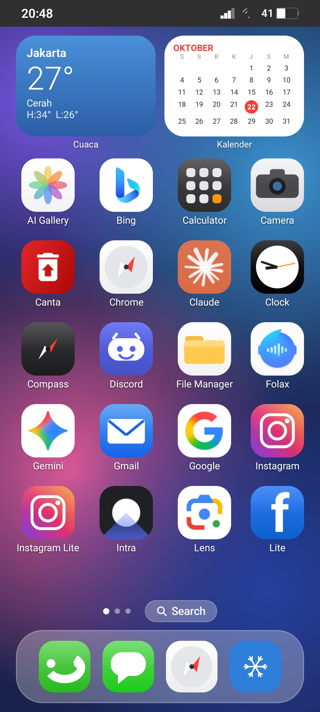
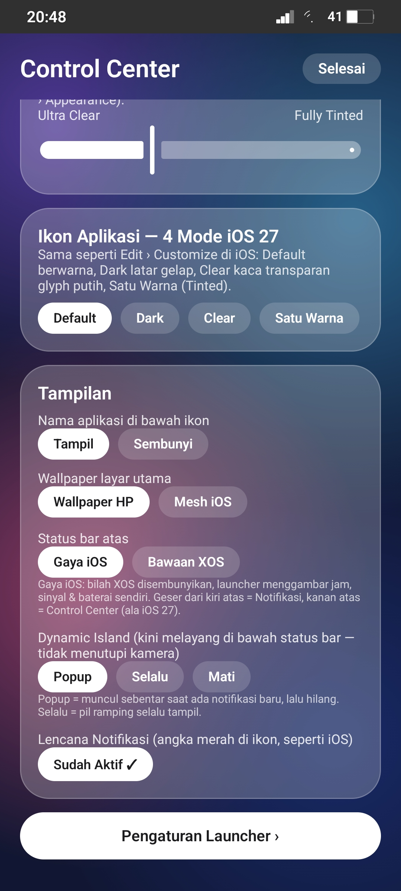
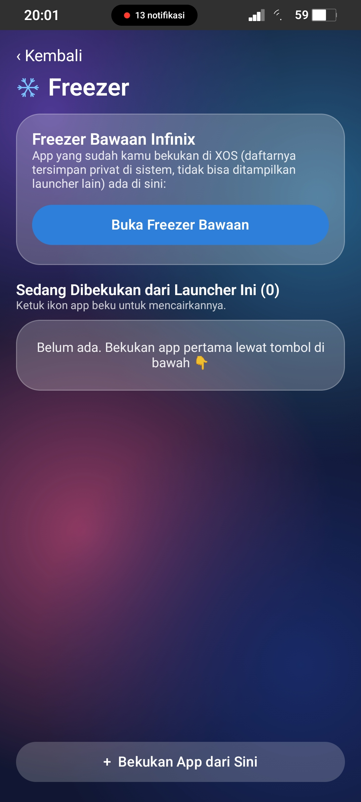
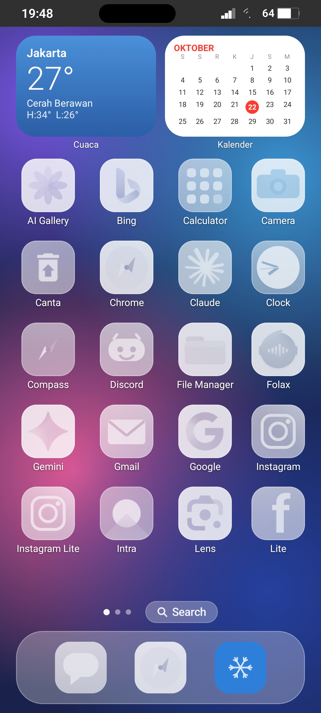
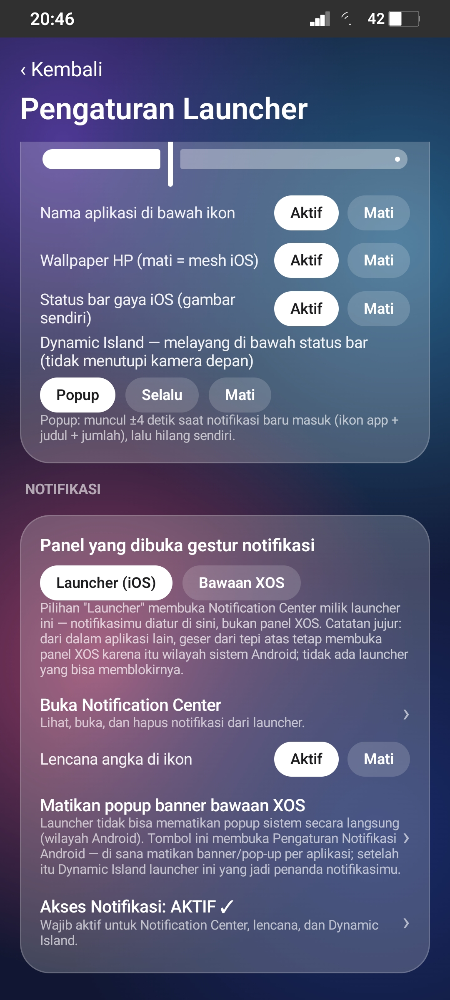

# iOS 27 Launcher for Android

> A custom Android launcher that brings the **iOS 27 look and feel** — Liquid Glass,
> Smart Stack widgets, Dynamic Island, App Library, and a one-color Tinted icon mode —
> to an **Infinix Note 12 (XOS / Android 13)**, while keeping the beloved XOS **Freezer**
> one tap away. No root. No Shizuku. No device-owner tricks.


<p align="center">
  
  
  
</p>

> 📸 All screenshots in this README were captured on a **real Infinix Note 12**
> (XOS, Android 13) running this launcher during development.

## Why this exists

Infinix's XOS Launcher cannot be re-skinned into an iOS look — but its **Freezer**
(the feature that "turns off" apps to save space and battery) is genuinely useful and
only exists inside XOS. This project is a from-scratch launcher that:

- recreates the iOS 27 home-screen experience as faithfully as a launcher can, and
- keeps Freezer reachable: a shortcut opens the **built-in XOS Freezer**, plus an
  in-launcher freeze list (hide + the system's own *Disable* switch — the exact same
  switch XOS Freezer flips, just without system privileges).

## Features

### Home screen
- iOS-style home: squircle icon grid (20 apps/page), labels with soft shadows, page dots + frosted **Search** pill
- **Smart Stack** widget pages you swipe through:
  - **Weather** (live data from Open-Meteo, with high/low) next to a white month **Calendar** with today circled in red
  - **Freezer** (ice-blue gradient) and **Device** card (real battery % and free storage, green gradient)
  - **XL widget** with location and quick chips
- **Dock** in Liquid Glass, auto-filled with Phone / Messages / Safari-style apps
- **App Library** — swipe up, or swipe past the last home page
- **Search or Ask** — full-screen black-glass search, like iOS 27 Spotlight
- **Jiggle mode** — long-press any icon: icons wiggle, **Edit › Customize** panel opens

### Icon appearance — all four iOS 27 modes
- **Default** (full color), **Dark**, **Clear** (frosted glass, white glyphs), **Tinted** (one single color — presets or your own)
- Hand-drawn iOS-style glyphs for popular apps (WhatsApp, Instagram, Telegram, TikTok, Spotify, Netflix, Shopee, myBCA, …) so icons still look right in Clear/Tinted modes
- **Liquid Glass slider** (Ultra Clear ↔ Fully Tinted), just like iOS 27's Settings › Appearance

### Dynamic Island & notifications
- iOS-style **red notification badges** with real counts (via Notification Access)
- A launcher-owned **Notification Center**: real notification content, grouped, tap to open the actual notification, per-item dismiss and *Clear All*
- **Dynamic Island popups that break through other apps**: a floating island appears over WhatsApp, games, browsers, … whenever a notification arrives (needs the one-time Android *"Display over other apps"* permission). It floats *below* the status bar, so the Note 12's centered punch-hole camera never covers it
- Three island modes: **Popup** (brief), **Always** (slim pill), **Off**
- iOS-style **status bar drawn by the launcher** (real clock, signal, battery) while XOS's bar is hidden — and the wallpaper is drawn edge-to-edge behind it, no black band

### Control Center & gestures
- Glass **Control Center** in a single tint color with drawn glyphs: connectivity, torch, DND, rotation lock, brightness/volume sliders, quick shortcuts, and a door into full launcher **Settings**
- Top-edge split gestures like iOS: **top-left = Notifications, top-right = Control Center**
- **8 fully mappable gestures** (Settings › Gestures): 1-finger swipe up/down, 2-finger swipe up/down, pinch in/out, 2-finger rotate CW/CCW → App Library, Search, Notification Center, Control Center, Freezer, Edit mode, Voice Search, Settings, or Off

### Freezer (the XOS way, minus the XOS launcher)
- One-tap shortcut to the **built-in Infinix Freezer** (it still lives in the system even when this launcher is default)
- In-launcher freeze list in iOS grouped-list design: *Freeze* hides the app and walks you to the system's **Disable** switch; frozen apps get a *Thaw* pill
- Honest limitation: XOS keeps its *own* frozen-app list in private system data, so no third-party app can display it — that's why the built-in Freezer shortcut exists

### Wallpaper
- Uses your phone's system wallpaper when readable, with a photo-picker fallback:
  **Settings › Appearance › Pick wallpaper from gallery** stores your photo inside the
  launcher, guaranteed to display (some OEMs, XOS included, don't share the system
  wallpaper with other apps)

## Screenshots

| Home — Default icons | Home — Clear mode | Freezer |
|---|---|---|
|  |  |  |

| Control Center | Launcher Settings |
|---|---|
|  |  |

## Installation

1. Download the latest APK from [Releases](../../releases) (or build it yourself, below).
2. Install it on your phone (allow *Install via USB / unknown apps* if Android asks).
3. Press **Home** and choose **iOS 27 Launcher → Always**.
4. One-time setup inside **Settings** (long-press an icon › Customize, or Control Center › Settings):
   - **Notification Access** — for badges, Notification Center, and Dynamic Island
   - **Display over other apps** — so the Island can float over other apps
   - *(Optional)* **Photos/Video** access — to read your system wallpaper, or just pick a wallpaper photo from the gallery in Settings

## Building from source

Requirements: JDK 17, Android SDK 35, Gradle 8.9 (or Android Studio Ladybug+).

```bash
git clone https://github.com/<your-username>/ios27-launcher.git
cd ios27-launcher
./gradlew assembleRelease
# APK -> app/build/outputs/apk/release/app-release.apk
```

> Release builds in this repo are signed with the included `debug.keystore` so every
> version installs over the previous one during development. Generate your own
> keystore before publishing anything serious.

## Tech stack

- **Kotlin 2.0** + **Jetpack Compose** (Material 3), single-activity architecture
- `NotificationListenerService` for badges / Notification Center / island triggers
- `WindowManager` `TYPE_APPLICATION_OVERLAY` for the cross-app Dynamic Island
- RenderEffect / ColorMatrix pipelines for the four icon modes; Canvas-drawn SF-style glyphs
- Open-Meteo API for the weather widget (no API key)
- Min SDK 29 (Android 10), target SDK 35

## Permissions — and why

| Permission | Used for |
|---|---|
| Notification Access | Badge counts, Notification Center, Dynamic Island triggers |
| Display over other apps | Floating Dynamic Island over other apps |
| Photos / Media (read) | Reading the system wallpaper you set |
| Internet | Weather widget (Open-Meteo) |
| Flashlight | Control Center torch toggle |
| Wi-Fi state | Signal indicator in the iOS-style status bar |

No analytics, no ads, no data collection. Weather coordinates are a fixed city (Jakarta) — no location tracking.

## Known limitations (honesty section)

- The XOS **lock screen** and the notification shade *inside other apps* belong to the system; a launcher can't replace them. Launcher gestures only apply while the launcher is in front.
- XOS's private frozen-app list can't be read by third-party apps (see Freezer above).
- iOS system features — **Siri AI**, Handoff, CarPlay, Apple's in-app UIs — are part of iOS itself and can't be replicated by an Android launcher.
- The status-bar signal indicator is Wi-Fi-derived, not raw cellular.

## Changelog

See [CHANGELOG.md](CHANGELOG.md) for the full version history (v0.1 → v0.14).

## License

MIT — do whatever you like, attribution appreciated.

---

*Built with ❤️ for one very patient Infinix Note 12 owner. Not affiliated with Apple Inc. or Transsion. "iOS" is a trademark of Apple Inc.; this is a look-alike study project.*
